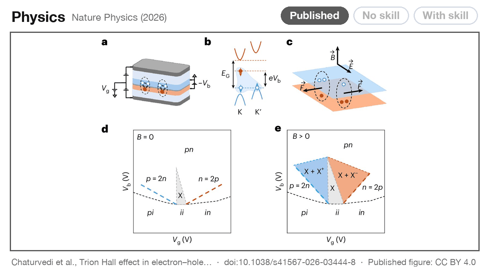

# schematic-figure

A skill for AI agents that draws publication-quality schematic figures for scientific papers. It gives you vector graphics (SVG and PDF) and the code that draws them, so you can edit any part. The story behind it is in our blog post, [Automating schematic figure making](https://lgwrightlab.github.io/schematic-figure/).



Each paper shows the published figure, Opus 5.5 without the skill, and Opus 5.5 with the skill. The first four papers were published after the model's training cutoff. The last is from our own lab, Wang et al. (2022). All five are CC BY.

**⚠️ The skill does not replace the person who designs the figure.** It gives a fast first draft and many design ideas. You still check the science and fine-tune the details.

<details>
<summary>Figure credits</summary>

Published figures are shown resized for display, under [CC BY 4.0](https://creativecommons.org/licenses/by/4.0/).

- Physics: Chaturvedi et al., [Trion Hall effect in electron–hole double layers](https://doi.org/10.1038/s41567-026-03444-8), Nature Physics (2026).
- Chemistry: Peng et al., [Divergent ring opening and functionalization of N-alkyl aziridines via boryl radical fragmentation](https://doi.org/10.1038/s41557-026-02247-x), Nature Chemistry (2026).
- Biology: Wang et al., [Scaling biodiversity-stability relationships from populations to meta-communities across trophic levels](https://doi.org/10.1038/s41467-026-75366-1), Nature Communications (2026).
- Materials: Liu et al., [Ultrafast directional hot carrier transfer in bilayer perovskite heterojunctions](https://doi.org/10.1038/s41467-026-76790-z), Nature Communications (2026).
- Optics: Wang et al., [An optical neural network using less than 1 photon per multiplication](https://doi.org/10.1038/s41467-021-27774-8), Nature Communications (2022).

</details>

## Install

Copy both skill folders into your skills folder (`patent-drawing` draws patent drawing sheets and uses the engine of `schematic-figure`):

```bash
git clone https://github.com/lgwrightlab/schematic-figure.git
mkdir -p ~/.claude/skills
cp -r schematic-figure/.claude/skills/* ~/.claude/skills/
```

You can also ask your agent to install it. In Codex, name the path of `SKILL.md` in your prompt. The skill needs Node.js 22 or later and a Chromium browser. Blender and RDKit are optional, for 3D renders and molecules.

## Use

Tips to use the skill in practice, from our own use:

- **Give it the full story.** A short request will work for well-known concepts. For a novel scientific concept, the skill needs a detailed technical description to work well. Example:

  > "Use the schematic-figure skill to design Fig. 1 for our paper [attach technical description]."

- **Show it a style to follow.** An example figure, from your earlier papers or one you admire, gives the skill a target for colours, line weights and level of detail. Example:

  > "Use the schematic-figure skill. Follow the colours and line weights of the attached figure from our last paper [attach example figure]. Draw our new device in the same style [attach technical description]."

- **Ask for several ideas at once.** We often run three agents in parallel on the same request. Each comes back with a different design, and we combine the best parts into one figure. Example:

  > "Use the schematic-figure skill. Make three different designs of this figure with three parallel agents for our paper [attach technical description] and combine them in a single sheet to show me."

- **Steer it with a few words.** The skill picks a look and an effort level for you, and says what it picked. You can set them yourself:
  - **Look:** say "flat" for a clean 2D diagram. Say "in 3D" for the skill's own vector 3D. Say "render it in Blender" for a rendered 3D object (this needs Blender installed). Say "photoreal" for a Blender render with photographic materials such as glass and metal.
  - **Size:** say "Width 89 mm" for a one-column journal figure, or "Width 183 mm" for two columns.
  - **Depth:** this is how much checking the agent does. "draft" is one quick pass with automatic checks, so you get a first look sooner and cheaper. "standard" adds a check of every count, direction and connection against your description, and a cold read of the result. The default, "full", also draws two versions, keeps the better one, and reviews it for errors.

  Example:

  > "Use the schematic-figure skill. Draw a lithium-ion cell while charging, in 3D. Width 89 mm, depth draft."

- **Work in a project folder.** The agent works in the folder where you start it. It writes the figure to `figure/out/` as SVG, PDF and PNG, sometimes inside a subfolder named after the figure. To change the figure, ask the agent in the same folder. For TIFF, EPS or PowerPoint, ask the agent to export the figure. This step needs Python 3 with Pillow, python-pptx and lxml, and `pdftops` or Ghostscript for EPS.

## Citation

We wrote up how we built and tested the skill in a blog post. If you find the skill useful in your work, please cite the post:

```bibtex
@article{zhao2026automating,
  title   = {Automating schematic figure making},
  author  = {Zhao, Jinchen and Wright, Logan},
  journal = {lgwrightlab.github.io},
  year    = {2026},
  month   = {Oct},
  url     = {https://lgwrightlab.github.io/schematic-figure/}
}
```

## License

MIT. The Latin Modern fonts in `.claude/skills/schematic-figure/foundation/fonts/` are under the GUST Font License, which ships beside them.
